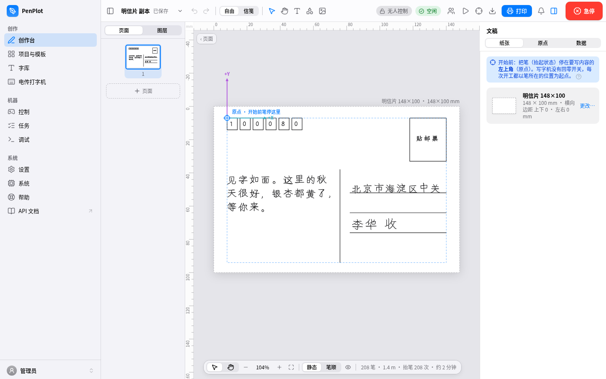
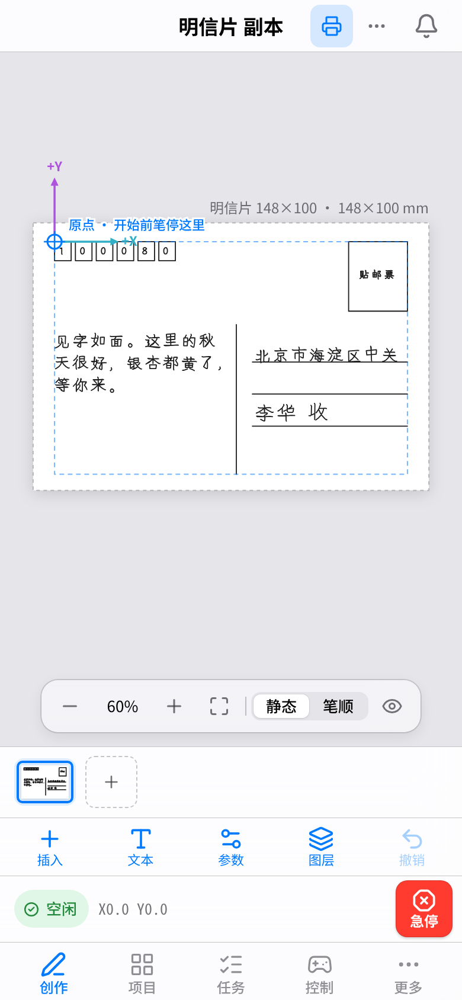
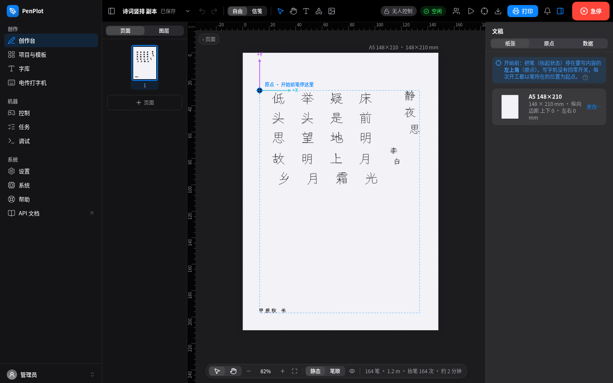
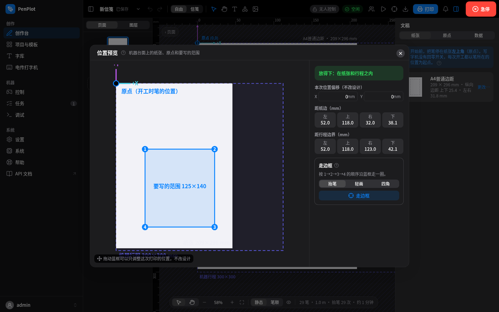
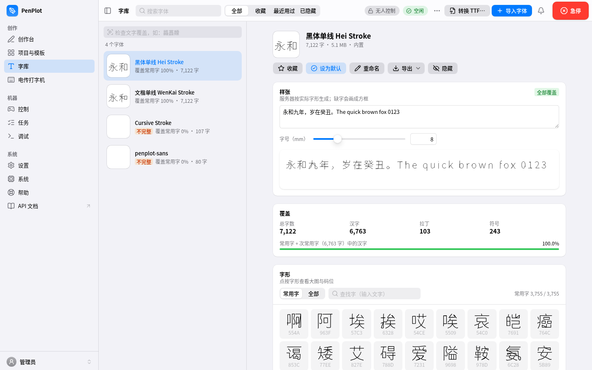
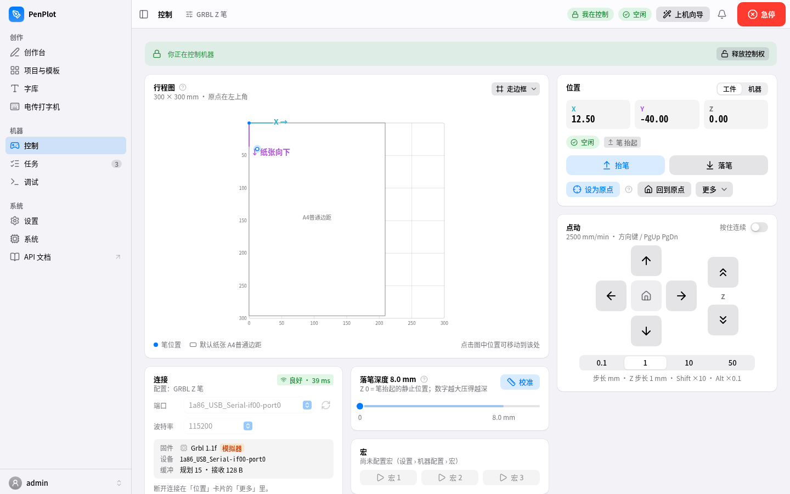
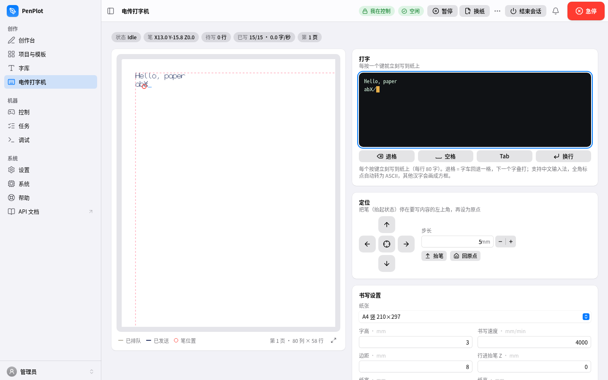
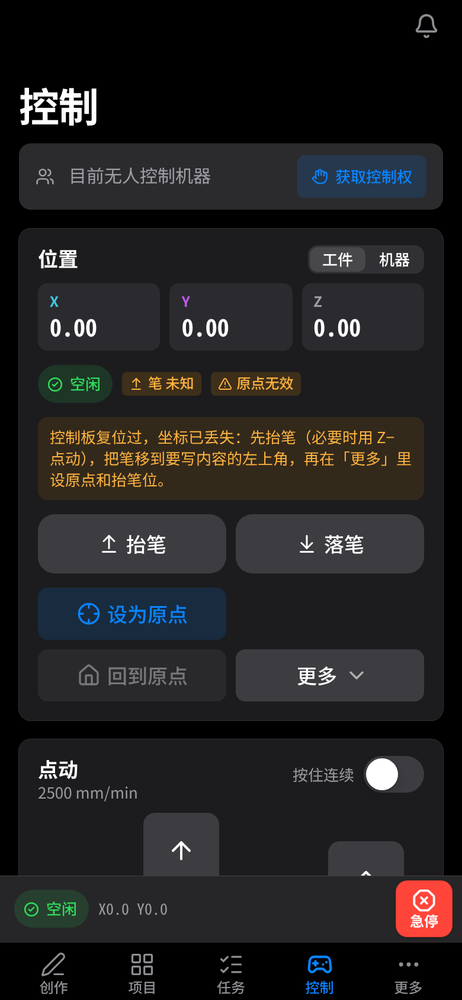

# penplot

**Pen-plotter / handwriting-machine toolkit + web workbench** (Python · Linux · Raspberry Pi / Orange Pi)

[中文](README.md) · [Manual (zh)](docs/manual/README.md) · [API (zh)](docs/api.md) · [Changelog](docs/CHANGELOG.md)

penplot turns an ordinary GRBL pen plotter into a device you drive from your phone:

- **Core library and CLI** (`penplot`): single-line (stroke) fonts, CJK-aware text layout (line-break
  rules, alignment, paragraphs, handwriting jitter), image-to-path, G-code generation, previews and
  flow-controlled serial streaming. The core needs only the Python standard library.
- **Web workbench** (`penplot-web`): runs on a small board next to the plotter and is used from a
  desktop, tablet or phone on the LAN — layout canvas, templates, mail-merge batches, font library,
  machine control, job queue, a "teletype" mode, multiple users with a control lease.

The UI and the user manual are in Simplified Chinese; the code, API and this README are in English.

<p align="center">
  
  
</p>

## Feature tour

| | |
|---|---|
|  |  |
| **Studio**: free layout and ruled-letter modes; text, shapes, images, SVG/DXF import, vertical text, pages and layers, stroke-order preview | **Position preview**: paper, origin and the area to be written drawn on the machine bed before printing; "trace frame" to check the position; out-of-travel warnings |
|  |  |
| **Fonts**: coverage stats, missing-glyph check, glyph browser, import `.psf`/`.gfont`, convert TTF to single-line | **Machine**: travel map, jog, pen up/down, set origin, pen-depth calibration, macros, firmware settings |
|  |  |
| **Teletype**: every key you press is written on paper; page change and continue | **Phone**: tab bar, always-visible E-stop, dark mode |

Also:

- **Templates and batches**: 14 built-in templates (letter paper, postcard, cards, envelope, practice grids,
  poems…); `{{variables}}` + CSV/Excel mail merge with a paper change per page.
- **Image tracing**: edges (Canny) / skeleton (single-stroke line art) / dots (laser halftone).
- **Jobs**: queued and streamed by the server, so a dropped client never stops a job; pause, resume,
  retry from a line; history.
- **Multi-user**: one account per member of the tenant with admin / operator / viewer roles; one user at a time holds the machine control lease;
  E-stop works for everyone; scoped API tokens.
- **System**: self-test (serial, firmware settings, latency, temperature, disk), logs, recovery.

## Supported hardware

| Controller | Notes |
|---|---|
| **GRBL** (recommended) | 0.9 / 1.1; pen on a Z stepper, a servo (`M3 S…`) or a laser |
| **Marlin** | servo `M280`, Z/E axis, fan output; line numbers + checksums + resend |
| **EBB** (EiBotBoard / AxiDraw-style) | `SP`/`XM` command stream |
| **K_AT** | auto-feed writing machine (Marlin dialect with paper wait / eject) |

**Reference machine** (the one penplot is developed and tested on): GRBL 1.1f, CH340 USB serial at
115200, 300 × 300 mm travel, **pen driven by the Z stepper: `Z0` = pen up (rest), `Z+8` = pen down**,
no limit switches and no homing — the pen position at power-on is the origin. Its profile is
[`configs/grbl-zpen.json`](configs/grbl-zpen.json). The controller board is an Orange Pi Zero 3
(2 GB, WiFi, aarch64); a Raspberry Pi 3/4/5 works the same way.

## Quick start

### 1. CLI

```bash
git clone https://github.com/<you>/penplot.git && cd penplot
python3 -m venv .venv && . .venv/bin/activate
pip install -e '.[all,dev]'           # or pick extras: .[machine] serial / .[image] / .[ttf] TTF conversion
penplot --version

penplot font list
penplot write "Hello, plotter" -f open-caveat-stroke --svg out.svg -o out.gcode --config configs/grbl-zpen.json
penplot tool  -p /dev/ttyUSB0 --config configs/grbl-zpen.json    # interactive console: penup/pendown/zero/jog/status
penplot print out.gcode -p /dev/ttyUSB0 --config configs/grbl-zpen.json
```

Other commands: `penplot font convert a.gfont a.psf` (lossless both ways), `penplot font ttf X.ttf out.psf --all`
(TTF → single-line), `penplot font mmah graphics.txt out.psf` (makemeahanzi stroke data),
`penplot img edge|skeleton|dots photo.png --width-mm 120 -o out.gcode`, `penplot gcode2svg any.gcode out.svg`.
`print` stops on a firmware `error` (pen up first, then return to origin) unless `--continue-on-error`;
`ALARM` aborts; Ctrl-C = pen up + return to origin.

### 2. Web workbench in dev mode (no hardware needed)

```bash
# backend with the simulated FakeGrbl plotter, no setup code, CORS for Vite
PENPLOT_DEV=1 PENPLOT_SERIAL_PORT=fake PENPLOT_DATA_DIR=~/.penplot-dev \
    penplot-web serve                 # http://localhost:8080, API docs at /api/v1/docs

# frontend (second terminal, Node 22)
cd webui && npm ci && npm run dev     # http://localhost:5173, proxies /api and the WebSocket to :8080
```

The first visit asks you to create the admin account, then opens the setup wizard.
`PENPLOT_DEV=1` is for development only — **never enable it on a real machine**.

### 3. Deploy to a Raspberry Pi / Orange Pi

Requirements: Python 3.12 on the board and root ssh with a key; Node 22, `rsync` and
[`uv`](https://github.com/astral-sh/uv) (only to re-lock dependencies) on the dev machine.

```bash
# (1) one-time board setup: user `penplot`, dirs, venv, systemd unit, serial udev rule
scp deploy/{bootstrap.sh,penplot-web.service,99-penplot-serial.rules,web.env.example,journald-penplot.conf} \
    root@plotter.local:/tmp/penplot-bootstrap/
ssh root@plotter.local 'bash /tmp/penplot-bootstrap/bootstrap.sh'        # add --port 8090 if 8080 is taken

# (2) release from the dev machine: build SPA -> upload -> preflight -> switch -> health check, auto-rollback
./deploy/deploy.sh root@plotter.local         # or export PENPLOT_DEPLOY_HOST=root@plotter.local

# (3) fonts live in the data dir (not in the release)
scp fonts/*.psf root@plotter.local:/var/lib/penplot/fonts/
ssh root@plotter.local 'chown -R penplot: /var/lib/penplot/fonts'

# (4) 8-digit setup code for the first login
ssh root@plotter.local 'cat /var/lib/penplot/setup-code'
```

Then open `http://plotter.local:8080` (or the board's IP) on the LAN. Settings are in
`/etc/penplot/web.env` (see [`deploy/web.env.example`](deploy/web.env.example)): port, data and font
dirs, serial port (`PENPLOT_SERIAL_PORT`, prefer `/dev/serial/by-id/...`), worker count, optional TLS.
The service runs as the unprivileged `penplot` user (group `dialout`) from a read-only release dir.
Forgot the password: `/opt/penplot/venv/bin/python -m penplot.web reset-password`.

### 4. Remote access (optional, Cloudflare Tunnel)

penplot is meant for the LAN. For access from outside, **do not forward ports**; run a Cloudflare
Tunnel from the board:

```bash
# on the board (cloudflared must run on the same host as penplot-web)
cloudflared tunnel login
cloudflared tunnel create penplot                       # note the <TUNNEL_ID>
cloudflared tunnel route dns penplot plotter.example.com
cat > /etc/cloudflared/config.yml <<'EOF'
tunnel: <TUNNEL_ID>
credentials-file: /etc/cloudflared/<TUNNEL_ID>.json
ingress:
  - hostname: plotter.example.com
    service: http://localhost:8080
  - service: http_status:404
EOF
cloudflared service install
```

Security notes:

- `CF-Connecting-IP` / `X-Forwarded-Proto` are trusted **only from loopback**, so cloudflared must run on
  the board; other LAN hosts cannot spoof them. Login rate limiting uses the real client IP.
- Requests through the tunnel are marked *remote*; the teletype **terminal mode refuses remote users**.
- Put a Cloudflare **Access** policy (one-time PIN / SSO) in front of the hostname, so remote users pass
  two layers of authentication.
- Give remote accounts the smallest role (viewer / operator) and API tokens the smallest scope; revoke
  unused tokens.
- Someone should be near the machine when it is driven remotely — it really moves.

Replace `<TUNNEL_ID>` and `plotter.example.com` with your own; never commit the tunnel credentials file.

## Fonts

Only freely redistributable fonts ship with the repository (details in [`fonts/README.md`](fonts/README.md)):

| Font | Glyphs | Source / licence |
|---|---|---|
| 文楷单线 WenKai Stroke (`open-wenkai-stroke`) | 7,122 | converted from LXGW WenKai, SIL OFL 1.1 |
| 黑体单线 Hei Stroke (`open-hei-stroke`) | 7,122 | converted from Noto Sans CJK SC, SIL OFL 1.1 |
| Cursive Stroke (`open-caveat-stroke`) | 107 | converted from Caveat, SIL OFL 1.1 |
| penplot-sans | 80 | original Latin/digit stroke font, built in |

The CJK fonts cover all 6,763 GB2312 level-1 and level-2 hanzi, ASCII and full-width punctuation.

Adding fonts:

- **`.psf`** — penplot's plain-text stroke-font format: `#psf 1`, `name`, `size`, then
  `glyph 0x4E2D [adv=N]` followed by `m x y` / `l x y` lines (y down, baseline 0). Drop it in the font
  dir or import it in the web UI.
- **`.gfont`** — the stroke-font format of some Chinese writing-machine software; read directly or
  converted with `penplot font convert`.
- **`.ttf/.otf/.ttc`** — `penplot font ttf FONT out.psf --all` (`--face N` for collections) or
  "Fonts → Convert TTF…" in the UI. `skeleton` mode (default) extracts stroke centre lines for pens;
  `--mode outline` keeps contours for lasers.

Font search order: `$PENPLOT_FONT_DIR` → `./fonts` → `./gcodeFonts` → repo `fonts/` → `~/.penplot/fonts`.
**Only commit fonts whose licence allows redistribution**: `.gitignore` allowlists `fonts/`, and
`*.gfont`, `*.ttc` and fonts converted from Windows fonts are always ignored.

## API

- Interactive docs on the device at `/api/v1/docs` (Swagger, login required); offline spec in
  [`docs/design/openapi.json`](docs/design/openapi.json).
- Guide with auth, tokens, curl / Python and WebSocket examples: [`docs/api.md`](docs/api.md) (Chinese).
- JSON examples for every resource: [`docs/design/04-contract-notes.md`](docs/design/04-contract-notes.md).

```bash
curl -H "Authorization: Bearer $PENPLOT_TOKEN" http://plotter.local:8080/api/v1/machine/status
```

## Safety

- **E-stop**: the red button top right or `Ctrl/⌘ + .`, available to every user without the control
  lease. After an E-stop the origin is invalid and must be set again. If the network is flaky,
  switching the plotter off is just as safe.
- **Origin and pen-up**: the reference machine has no limit switches. Before a job, **raise the pen** and
  park it at the **top-left corner** of the area to write, then set the origin; check the area with
  *Position preview / Trace frame*.
- Don't set the pen depth too deep; keep hands, hair and sleeves away from rails and belts; don't leave
  long batches unattended.
- Don't expose the board directly to the internet. Teletype terminal mode is a shell with the
  service account's rights — use it on trusted networks only.

See [SECURITY.md](SECURITY.md) for reporting vulnerabilities and deployment hardening.

## Project layout

```
penplot/          Python package: fonts (gfont/psf/ttf/mmah), layout, compose, geometry, gcode,
                  image, importers/export, machine/ (grbl, marlin, ebb, kat, sender), cli, web/ (FastAPI)
webui/            React 19 + TypeScript + Vite frontend
fonts/            open single-line fonts (allowlisted), licences, previews, build scripts
configs/          machine profiles          seed/     paper presets, templates, sample data
deploy/           board bootstrap, release script, systemd/udev
demos/teletype/   standalone teletype demo (stdlib + pyserial)
tests/            pytest (core + web/)       e2e/      Playwright end-to-end (real backend + FakeGrbl)
docs/             manual, API guide, design docs, file-format notes
```

## Development and tests

```bash
pip install -e '.[all,dev]'
OPENBLAS_NUM_THREADS=1 python -m pytest -q       # ~1 min
cd webui && npm ci && npm run lint && npm run build
cd e2e && npm ci && npx playwright install chromium webkit && npx playwright test   # ~8 min
```

A few legacy checks need Windows fonts (SimSun / Microsoft YaHei / Arial); they run only when
`PENPLOT_TTF_DIR` points at a folder with them and skip otherwise. After API changes:
`penplot-web dump-openapi > docs/design/openapi.json && (cd webui && npm run gen:api)`.
See [CONTRIBUTING.md](CONTRIBUTING.md).

## Roadmap

- [ ] More open single-line fonts (kaishu / xingshu from real stroke-order data)
- [ ] UI languages other than Chinese
- [ ] SD-card upload printing (Marlin `M28/M29`)
- [ ] Several plotters from one workbench
- [ ] Real-hardware validation for auto-feed (K_AT) machines
- [ ] Byte-exact handwriting-jitter sequences compared with existing writing-machine software

## Credits

[LXGW WenKai](https://github.com/lxgw/LxgwWenKai), [Noto CJK](https://github.com/notofonts/noto-cjk) and
[Caveat](https://github.com/googlefonts/caveat) (sources of the bundled stroke fonts),
[makemeahanzi](https://github.com/skishore/makemeahanzi), [GRBL](https://github.com/gnea/grbl),
[xterm.js](https://xtermjs.org/), FastAPI, React, Radix UI, TanStack Query, scikit-image, fontTools.
Full list: [THIRD_PARTY_NOTICES.md](THIRD_PARTY_NOTICES.md).

## License

- Code: **GNU Affero General Public License v3.0 or later** (`AGPL-3.0-or-later`), see [LICENSE](LICENSE).
  If you modify penplot and let others use it over a network, you must offer them your modified source.
- Bundled fonts: `fonts/open-*.psf` are under the SIL Open Font License 1.1 ([`fonts/LICENSES/`](fonts/LICENSES/));
  `penplot-sans` is covered by the project licence.
- penplot reads and writes the `.gfont` format and produces compatible G-code for interoperability only;
  it contains no code or fonts from other writing-machine software. Product names belong to their owners.
