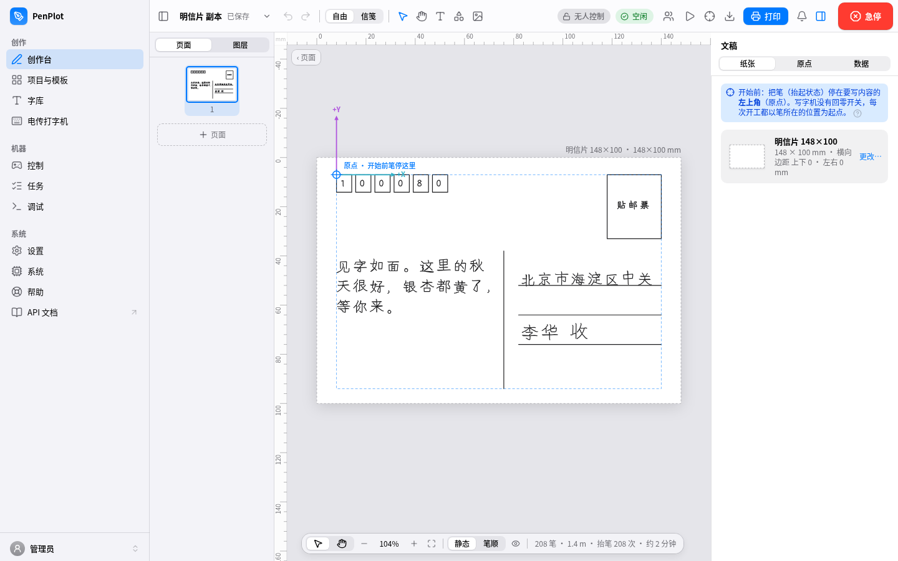
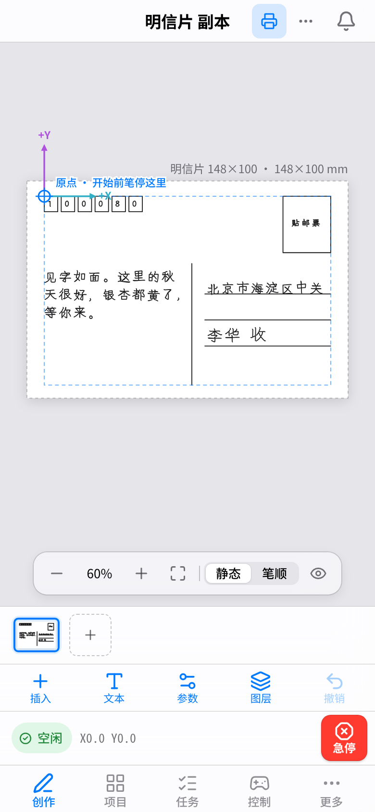
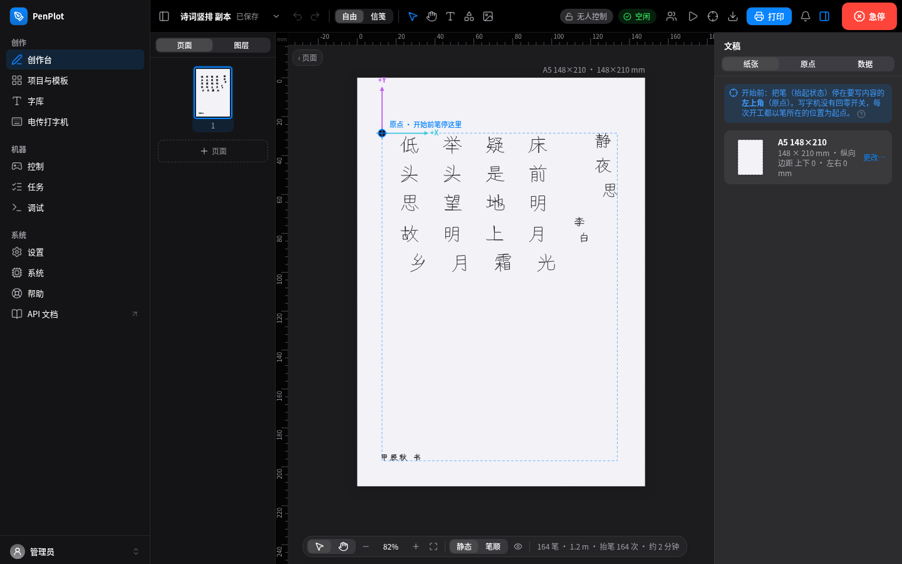
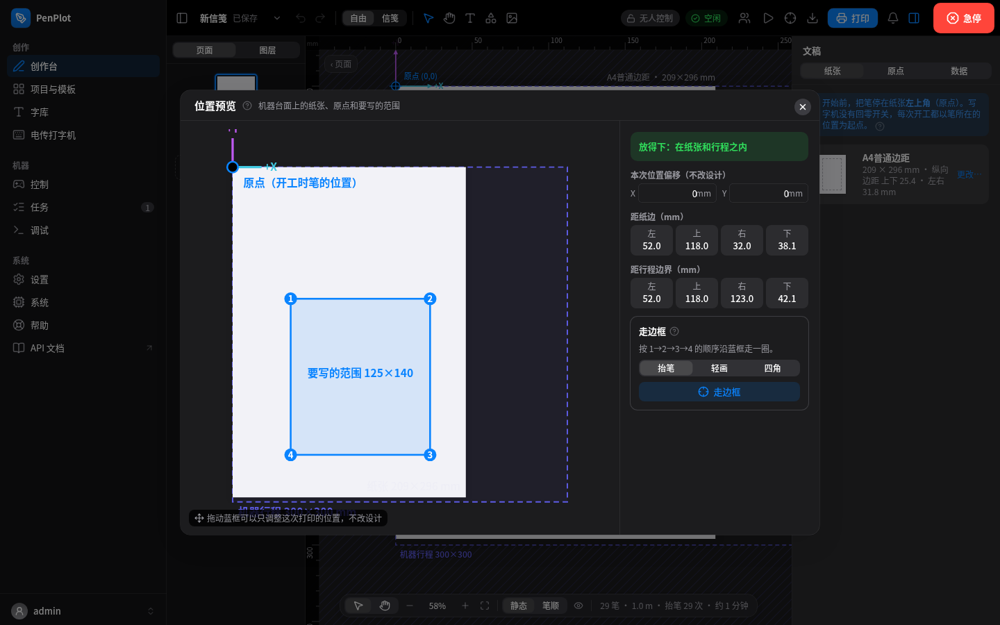
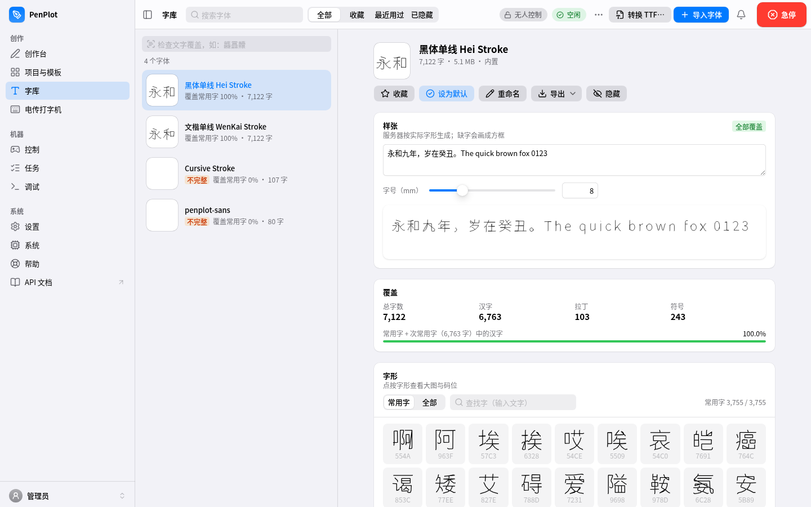
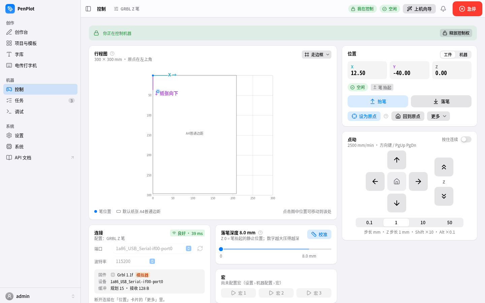
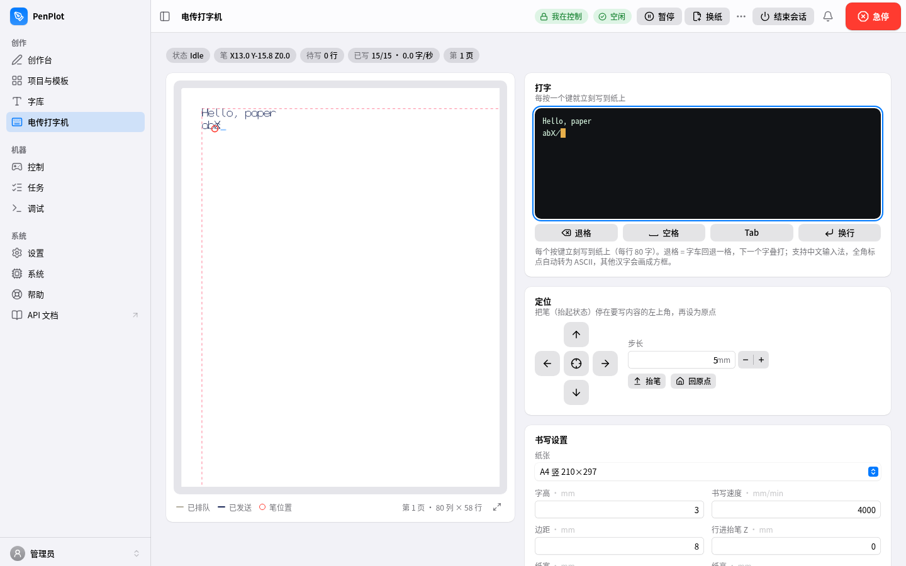
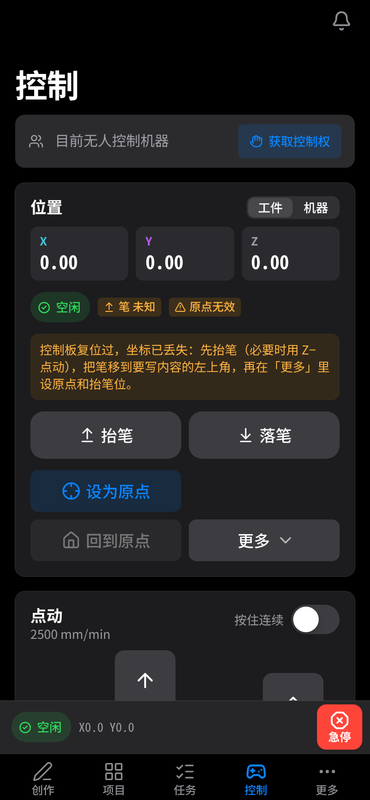

# penplot

**写字机 / 笔式绘图仪工具包 + 网页工作台**（Python · Linux · 树莓派 / Orange Pi）

[English](README.en.md) · [使用手册](docs/manual/README.md) · [API](docs/api.md) · [更新日志](docs/CHANGELOG.md)

penplot 把一台普通的 GRBL 写字机变成"打开手机就能写字"的设备：

- **核心库与命令行**（`penplot`）：单线字体、中文排版（换行禁则、对齐、段落、手写抖动）、图片转路径、
  G 代码生成、预览、串口流控发送。核心只依赖 Python 标准库。
- **网页工作台**（`penplot-web`）：跑在写字机旁边的小板子上，局域网里用电脑、平板、手机打开。
  排版画布、模板、批量信件、字库管理、机器控制、任务队列、电传打字机，多用户与控制权。

<p align="center">
  
  
</p>

## 功能一览

| | |
|---|---|
|  |  |
| **创作台**：自由排版 / 信笺两种模式，文本、形状、图片、SVG/DXF 导入，竖排，页面与图层，笔顺预览 | **位置预览**：打印前在机台上画出纸张、原点和书写范围，可"走边框"确认位置，越界会提示 |
|  |  |
| **字库**：覆盖率统计、缺字检查、字形浏览、导入 `.psf`/`.gfont`，TTF 一键转单线 | **控制**：行程图、点动、抬笔/落笔、设原点、落笔深度校准、宏、固件参数 |
|  |  |
| **电传打字机**：每按一个键就写到纸上，换纸续写 | **手机**：底部标签栏、常驻急停，深色模式 |

其他：

- **模板与批量**：14 个内置模板（信笺、明信片、贺卡、信封、田字格、诗词…），`{{变量}}` + CSV/Excel 批量出信，每页自动换纸。
- **图片描线**：边缘（Canny）/ 骨架（单笔线稿）/ 点阵（激光半调）。
- **任务**：服务端排队和流控，断网不中断；暂停 / 继续 / 从某行重试；历史记录。
- **多用户**：为租户的每位成员分别建账号，管理员 / 操作员 / 只读三种角色；同一时刻只有一人持有机器"控制权"，急停对所有人有效；API 令牌按权限范围授权。
- **系统**：自检诊断（串口、固件参数、延迟、温度、磁盘）、日志、恢复。

## 支持的硬件

| 控制器 | 说明 |
|---|---|
| **GRBL**（推荐） | 0.9 / 1.1；笔可以是 Z 轴步进、舵机（`M3 S…`）或激光 |
| **Marlin** | 舵机 `M280`、Z/E 轴、风扇口；行号 + 校验和 + 重发 |
| **EBB**（EiBotBoard / AxiDraw 类） | `SP`/`XM` 命令流 |
| **K_AT** | 自动送纸写字机（Marlin 方言，等纸 / 出纸） |

**参考机型**（开发与测试用的那台）：GRBL 1.1f，CH340 USB 串口 115200，行程 300 × 300 mm，
**笔由 Z 轴步进驱动：`Z0` 抬笔（静止位），`Z+8` 落笔**，没有限位开关、不归零（homing）——
每次开机以笔所在位置为原点。配置在 [`configs/grbl-zpen.json`](configs/grbl-zpen.json)。
控制盒是 Orange Pi Zero 3（2 GB，WiFi，aarch64），树莓派 3/4/5 同样可以。

## 快速开始

### 1. 命令行

```bash
git clone https://github.com/<你的账号>/penplot.git && cd penplot
python3 -m venv .venv && . .venv/bin/activate
pip install -e '.[all,dev]'            # 或按需：.[machine] 串口 / .[image] 图片 / .[ttf] TTF 转换
penplot --version

penplot font list                                       # 列出字体
penplot write "床前明月光，疑是地上霜。" -f open-wenkai-stroke \
    --svg out.svg -o out.gcode --config configs/grbl-zpen.json
penplot tool  -p /dev/ttyUSB0 --config configs/grbl-zpen.json   # 交互控制台：penup/pendown/zero/jog/status
penplot print out.gcode -p /dev/ttyUSB0 --config configs/grbl-zpen.json
```

<details>
<summary>更多命令</summary>

```bash
# 字体
penplot font convert old.gfont new.psf                  # .gfont <-> .psf 无损互转
penplot font ttf 某字体.ttf my-hand.psf --all            # TTF -> 单线手写体（GB2312 一二级 + 全角标点）
penplot font mmah graphics.txt mmah.psf                 # makemeahanzi 笔顺数据 -> 单线字体

# 排版选项
#   --page 预设(A4/A3/16开 × 4 种边距) --text-size --char-space --align L|C|R|D(分散)
#   --seed 固定手写抖动  --font-mix "a:0.6,b:0.4" 逐字混排  --optimize 路径排序  --work W H 越界警告

# 图片转路径
penplot img edge     photo.png --width-mm 120 -o e.gcode     # 轮廓
penplot img skeleton photo.png --width-mm 120 -o s.gcode     # 中心线（单笔线稿）
penplot img dots     photo.png --width-mm 120 --spacing-mm 1.5 --power-modulate -o d.gcode   # 激光点阵

penplot gcode2svg any.gcode out.svg                     # 任意 G 代码导入预览
```

`print` 遇到固件 `error` 默认停止（先抬笔再回原点），`--continue-on-error` 改为记录后继续；
`ALARM` 立即中止；Ctrl-C = 抬笔 + 回原点。
</details>

### 2. 网页工作台（开发模式，不需要硬件）

```bash
# 后端：FakeGrbl 模拟写字机，免初始化码，允许 Vite 跨域
PENPLOT_DEV=1 PENPLOT_SERIAL_PORT=fake PENPLOT_DATA_DIR=~/.penplot-dev \
    penplot-web serve                   # http://localhost:8080，API 文档 /api/v1/docs

# 前端（另开终端，Node 22）
cd webui && npm ci && npm run dev       # http://localhost:5173，/api 与 WebSocket 代理到 :8080
```

第一次打开会进入"创建管理员"页面，然后是上机向导。`PENPLOT_DEV=1` 只用于开发，**不要在真机上开启**。

### 3. 部署到树莓派 / Orange Pi

需要：板子上有 Python 3.12、能用 root 通过 ssh 密钥登录；开发机上有 Node 22、`rsync`、[`uv`](https://github.com/astral-sh/uv)（只在依赖变化时用于生成锁文件）。

```bash
# (1) 一次性初始化板子：建用户 penplot、目录、venv、systemd 服务、串口 udev 规则
scp deploy/{bootstrap.sh,penplot-web.service,99-penplot-serial.rules,web.env.example,journald-penplot.conf} \
    root@plotter.local:/tmp/penplot-bootstrap/
ssh root@plotter.local 'bash /tmp/penplot-bootstrap/bootstrap.sh'        # 端口被占用时加 --port 8090

# (2) 从开发机发布（构建前端 → 上传新版本 → 预检 → 切换 → 健康检查，失败自动回滚）
./deploy/deploy.sh root@plotter.local          # 或 export PENPLOT_DEPLOY_HOST=root@plotter.local

# (3) 字体放到数据目录（发布包不含字体）
scp fonts/*.psf root@plotter.local:/var/lib/penplot/fonts/
ssh root@plotter.local 'chown -R penplot: /var/lib/penplot/fonts'

# (4) 查看首次登录用的 8 位初始化码
ssh root@plotter.local 'cat /var/lib/penplot/setup-code'
```

然后在同一局域网里打开 `http://plotter.local:8080`（或板子的 IP）。配置在 `/etc/penplot/web.env`
（见 [`deploy/web.env.example`](deploy/web.env.example)）：端口、数据目录、字体目录、串口
（`PENPLOT_SERIAL_PORT`，建议用 `/dev/serial/by-id/...`）、任务进程数、可选 HTTPS 证书。
服务以低权限用户 `penplot` 运行（`dialout` 组），发布目录只读。
忘记密码：`/opt/penplot/venv/bin/python -m penplot.web reset-password`。

### 4. 远程访问（可选，Cloudflare Tunnel）

默认只在局域网里用。需要在外面访问时，**不要做端口映射**，用 Cloudflare Tunnel 从板子向外建立隧道：

```bash
# 在板子上（cloudflared 必须和 penplot-web 在同一台机器上）
cloudflared tunnel login
cloudflared tunnel create penplot                       # 记下输出的 <TUNNEL_ID>
cloudflared tunnel route dns penplot plotter.example.com
cat > /etc/cloudflared/config.yml <<'EOF'
tunnel: <TUNNEL_ID>
credentials-file: /etc/cloudflared/<TUNNEL_ID>.json
ingress:
  - hostname: plotter.example.com
    service: http://localhost:8080
  - service: http_status:404
EOF
cloudflared service install
```

安全要点：

- penplot 只在请求**来自本机回环地址**时才信任 `CF-Connecting-IP` / `X-Forwarded-Proto`，所以 cloudflared
  必须跑在板子上；局域网里的其他设备无法伪造这些头。登录限速按真实客户端 IP 计算。
- 经隧道来的请求被标记为"远程"：电传打字机的**终端模式拒绝远程用户**。
- 强烈建议在 Cloudflare Zero Trust 里给这个主机名加一层 **Access** 策略（邮箱验证码 / SSO），
  再加上 penplot 自己的账号密码，做到两层认证。
- 给远程使用的账号分配最小角色（只读 / 操作员），API 令牌只授予需要的范围，不用就吊销。
- 远程开机器时旁边最好有人：写字机会真的动起来。

`<TUNNEL_ID>`、`plotter.example.com` 换成你自己的；隧道凭据文件不要提交到任何仓库。

## 字体

仓库只附带可以自由再分发的字体（详见 [`fonts/README.md`](fonts/README.md)）：

| 字体 | 字数 | 来源 / 许可 |
|---|---|---|
| 文楷单线 WenKai Stroke（`open-wenkai-stroke`） | 7 122 | 由 LXGW WenKai 转换，SIL OFL 1.1 |
| 黑体单线 Hei Stroke（`open-hei-stroke`） | 7 122 | 由 Noto Sans CJK SC 转换，SIL OFL 1.1 |
| Cursive Stroke（`open-caveat-stroke`） | 107 | 由 Caveat 转换，SIL OFL 1.1 |
| penplot-sans | 80 | 原创英数单线体，内置，无字体时自动可用 |

中文字体覆盖 GB2312 一二级汉字（6 763 字）、ASCII 和全角标点。

添加自己的字体：

- **`.psf`**：penplot 的明文单线格式（见下），直接放进字体目录或在网页「字库 → 导入字体」。
- **`.gfont`**：一些国产写字机软件的单线字体格式，可直接使用，或 `penplot font convert` 转成 `.psf`。
- **`.ttf/.otf/.ttc`**：`penplot font ttf 字体文件 输出.psf --all`（`.ttc` 用 `--face N` 选字面），
  或网页「字库 → 转换 TTF…」。默认 `skeleton` 模式提取笔画中心线（适合写字），`--mode outline` 保留轮廓（适合激光）。

字体目录查找顺序：`$PENPLOT_FONT_DIR` → `./fonts` → `./gcodeFonts` → 仓库 `fonts/` → `~/.penplot/fonts`。
**请只提交有再分发许可的字体**：`.gitignore` 对 `fonts/` 用白名单，`*.gfont`、`*.ttc` 和由 Windows 字体转换的文件一律忽略。

<details>
<summary>PSF 明文字体格式（v1）</summary>

UTF-8 纯文本，`#` 注释，行式语法；坐标 y 向下，基线为 0：

```
#psf 1
name 我的字体
size 100

glyph 0x4E2D 中
m -80 -212
l 0 -212
l ...
```

`glyph` 行可带 `adv=` 指定字宽。`.psf` 和 `.gfont` 可无损互转，也很适合做 diff 和版本管理。
</details>

## API

- 交互式文档：设备上的 `/api/v1/docs`（Swagger，需要登录），离线规范 [`docs/design/openapi.json`](docs/design/openapi.json)
- 使用说明（认证、令牌、curl / Python 示例、WebSocket 事件）：[`docs/api.md`](docs/api.md)
- 各数据结构的 JSON 样例：[`docs/design/04-contract-notes.md`](docs/design/04-contract-notes.md)

```bash
curl -H "Authorization: Bearer $PENPLOT_TOKEN" http://plotter.local:8080/api/v1/machine/status
```

## 安全须知

- **急停**：屏幕右上角红色按钮或 `Ctrl/⌘ + .`，任何用户都能按，不需要控制权。急停后原点失效，需要重新设原点。
  网络不稳时，直接关写字机电源同样安全。
- **原点与抬笔**：参考机型没有限位开关，开工前要把笔**抬起**并停在要写内容的**左上角**再设原点；
  打印前用「位置预览 / 走边框」确认范围在纸内、在行程内。
- 落笔深度不要调得过深；机器运动时手、头发、袖口远离导轨和皮带；不要让机器无人看管地连续批量写字。
- 不要把控制盒直接暴露在公网（见上面的远程访问）。电传打字机的终端模式拥有服务账号的 shell 权限，只在可信网络里使用。

完整内容见 [安全须知](docs/manual/10-safety.md) 和 [SECURITY.md](SECURITY.md)。

## 项目结构

```
penplot/              Python 包
├── gfont.py psf.py   字体格式（.gfont 读写、.psf 明文格式、互转）
├── builtin_font.py   内置 penplot-sans
├── ttffont.py mmah.py   TTF / makemeahanzi -> 单线字体
├── layout.py         排版：页面、换行禁则、对齐（含分散）、段落、手写抖动
├── compose.py        多元素版面（文本、形状、图片）
├── geometry.py       路径、仿射变换、RDP
├── gcode.py          路径优化、四种固件的 G 代码、G 代码导入
├── image.py          边缘 / 骨架 / 点阵
├── importers/ export/   SVG、DXF、Excel 导入；导出
├── machine/          串口控制（grbl / marlin / ebb / kat + 流控发送器）
├── cli.py            命令行
└── web/              FastAPI 后端：认证、项目、渲染、任务、机器服务、WebSocket、电传打字机
webui/                React 19 + TypeScript + Vite 前端
fonts/                开源单线字体（白名单）、许可证、预览、生成脚本
configs/              机器配置（grbl-zpen.json）
seed/                 纸张预设、模板、示例数据
deploy/               板子初始化、发布脚本、systemd / udev
demos/teletype/       独立的电传打字机演示（标准库 + pyserial）
tests/                pytest（核心 + web/）
e2e/                  Playwright 端到端测试（真后端 + FakeGrbl）
docs/                 手册、API 说明、设计文档、格式说明
```

## 开发与测试

```bash
pip install -e '.[all,dev]'
OPENBLAS_NUM_THREADS=1 python -m pytest -q        # 约 1 分钟
python -m pytest tests/web -q                     # 只跑后端 API

cd webui && npm ci && npm run lint && npm run build

cd e2e && npm ci && npx playwright install chromium webkit
npx playwright test                               # 构建前端 + 启动真后端（FakeGrbl），约 8 分钟
```

- 少量旧校验脚本需要 Windows 字体（宋体 / 微软雅黑 / Arial）：设置 `PENPLOT_TTF_DIR=目录` 才会运行，否则跳过。
- 改了 API 后：`penplot-web dump-openapi > docs/design/openapi.json`，再 `cd webui && npm run gen:api`。
- 网页帮助的源文件在 `webui/src/features/help/articles/`，改完复制到 `docs/manual/`。

贡献方式见 [CONTRIBUTING.md](CONTRIBUTING.md)。

## 路线图

- [ ] 更多开源单线字体（基于真实笔顺数据的楷书、行书）
- [ ] 中文以外的界面语言
- [ ] SD 卡上传打印（Marlin `M28/M29`）
- [ ] 多台写字机同时管理
- [ ] 自动送纸机型（K_AT）的真机验证
- [ ] 与原有写字机软件输出的逐字节对照（随机抖动序列）

## 致谢

- [LXGW WenKai / 霞鹜文楷](https://github.com/lxgw/LxgwWenKai)、[Noto CJK](https://github.com/notofonts/noto-cjk)、
  [Caveat](https://github.com/googlefonts/caveat)：转换随附单线字体所用的开源字体
- [makemeahanzi](https://github.com/skishore/makemeahanzi)：汉字笔顺数据
- [GRBL](https://github.com/gnea/grbl)、[xterm.js](https://xtermjs.org/)、FastAPI、React、Radix UI、TanStack Query、
  scikit-image、fontTools 等开源项目

第三方许可汇总见 [THIRD_PARTY_NOTICES.md](THIRD_PARTY_NOTICES.md)。

## 许可

- 代码：**GNU Affero General Public License v3.0 or later**（`AGPL-3.0-or-later`），全文见 [LICENSE](LICENSE)。
  如果你修改 penplot 并通过网络向他人提供服务，需要向这些用户提供修改后的源代码。
- 随附字体：`fonts/open-*.psf` 为 SIL Open Font License 1.1，见 [`fonts/LICENSES/`](fonts/LICENSES/)；
  `penplot-sans` 随项目许可。
- penplot 能读写某些写字机软件使用的 `.gfont` 格式并生成兼容的 G 代码，仅为互操作；本项目不包含这些软件的任何代码或字体，
  相关名称归各自所有者。
